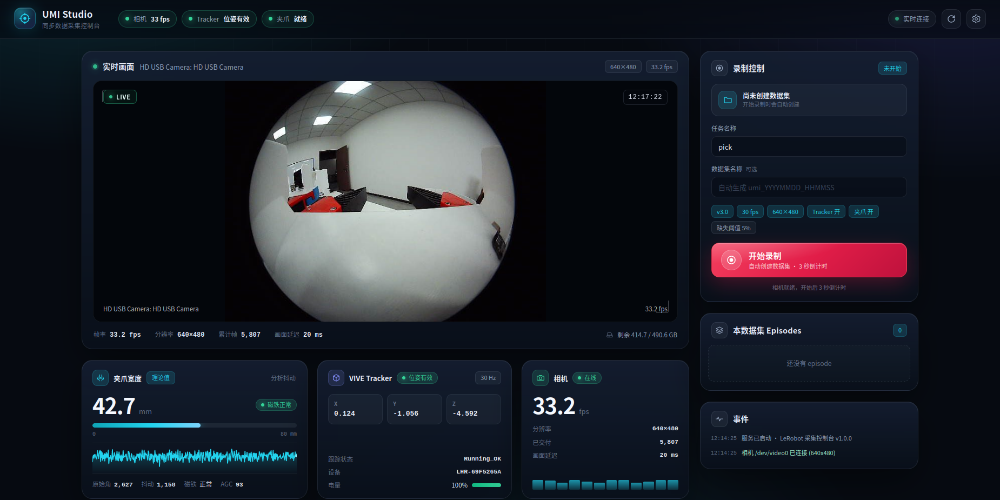

# Camera detection and browser preview

This program lists all Linux V4L2 video capture devices and previews them in a browser. Metadata-only `/dev/video*` nodes are excluded.

Requirements: Python 3, OpenCV (`cv2`), and `v4l2-ctl` (`v4l-utils`). These are installed on this machine.

```bash
cd /home/zy/workspace/supre_umi
python3 camera_preview.py list --check
python3 camera_preview.py serve
```

Open `http://127.0.0.1:8765/` in a browser on the machine. If working remotely, forward the port with `ssh -p 7022 -L 8765:127.0.0.1:8765 zy@23.254.219.130`, then open the same URL locally. Use `python3 camera_preview.py serve --host 0.0.0.0` only on a trusted network, since the preview has no authentication.

`python3 camera_preview.py list --json` provides machine-readable device details. `GET /devices` returns the same list; `GET /snapshot?device=/dev/video0` returns one JPEG frame; `GET /stream?device=/dev/video0` returns an MJPEG stream. Refresh the page after plugging or unplugging cameras.

## UMI device status tools

The AS5600 gripper encoder, Vive Tracker and USB camera can be inspected together with
`umi_devices/umi_status.py`. See [umi_devices/README.md](umi_devices/README.md).

## Reports

- [2026-10-27 device verification and collector work log](docs/reports/2026-10-27-umi-device-and-collector.md)

## Web 控制台（UMI Studio）

三路设备实时预览、录制控制、QC 统计与数据集管理：

```bash
cd /home/zy/workspace/supre_umi/umi_devices
./start_web.sh
# 远端访问：
ssh -p 7022 -L 8770:127.0.0.1:8770 zy@23.254.219.130
```

浏览器打开 `http://127.0.0.1:8770/`。详细说明见
[umi_devices/README.md](umi_devices/README.md#web-控制台umi-studio)。



公网入口：`http://23.254.219.130:7080/`（frpc 转发到本机 `127.0.0.1:8770`）。
当前未启用认证，公网长期开放前请按
[umi_devices/README.md](umi_devices/README.md#公网访问frpc-7080) 启用 Basic 认证。

数据集库支持逐 episode 数据浏览：视频播放、夹爪宽度/Tracker 位置/四元数曲线、
悬停取值与点击跳转。详见
[umi_devices/README.md](umi_devices/README.md#数据集数据浏览)。

## User guide

- [UMI Studio 使用手册（最终用户）](docs/USER_GUIDE.md)
# supre_umi
