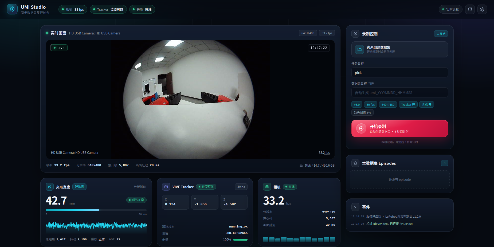
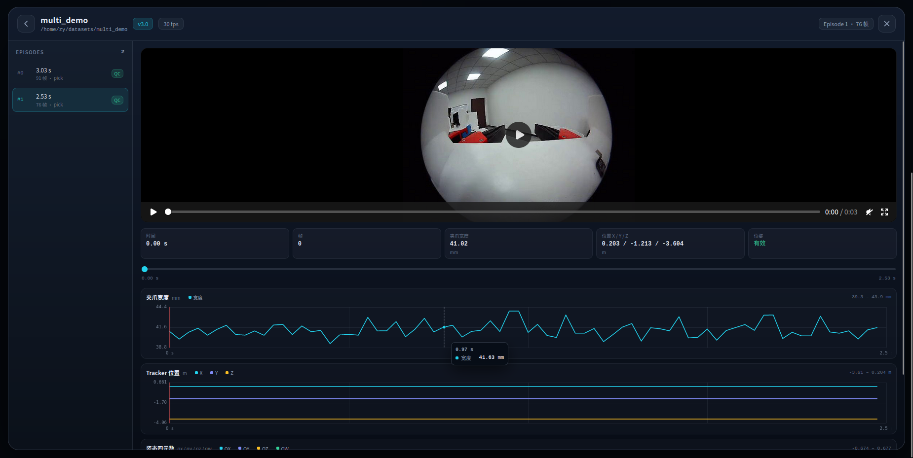

# UMI 设备状态与信息工具

读取自制 UMI 夹爪三路采集设备的状态：AS5600 夹爪宽度编码器、Vive Tracker
（经 SteamVR/OpenVR）和 USB 摄像头。设备背景见
[`../docs/devices/`](../docs/devices/)。

## 组成

| 文件 | 作用 |
| --- | --- |
| `umi_status.py` | 汇总三路状态，输出人读文本或 `--json`；任一设备失败不影响其他设备汇报 |
| `gripper_as5600.py` | AS5600 读取、流式采样、两点标定宽度换算 |
| `tracker_openvr.py` | OpenVR 设备枚举与位姿，需在 openvr 的 venv 下运行 |
| `camera_v4l2.py` | V4L2 摄像头列举与接近实际帧率检查 |

`umi_status.py` 用系统 `python3` 运行；它会在需要时自动调用
`/home/zy/tools/streamvr/.venv/bin/python` 查询 Tracker，因此不需要手动切换解释器。

## 一次性权限设置

读取 AS5600 需要访问 `/dev/i2c-*`，当前该节点属 `root:i2c`、权限 `0660`。把用户加入
`i2c` 组后无需每次 `sudo`（需重新登录，或临时用 `newgrp i2c` / `sg i2c -c`）：

```bash
sudo usermod -aG i2c zy
# 注销并重新登录后生效；当前会话内可临时使用：
sg i2c -c 'python3 umi_status.py'
```

也可以在有硬件访问权限的前提下保持用 `sudo -E` 运行，但 Tracker 查询需要用户会话中的
SteamVR，`sudo` 下通常无法连接，因此推荐用组权限方式。

## 用法

```bash
cd /home/zy/workspace/supre_umi/umi_devices

# 汇总状态（默认读 8 次编码器取均值，读 3 帧检查相机）
python3 umi_status.py
python3 umi_status.py --json
python3 umi_status.py --avg 16 --camera-frames 10

# 只看 AS5600
python3 gripper_as5600.py                 # 单次
python3 gripper_as5600.py --hz 20 --count 20
python3 gripper_as5600.py --calib 1500,2600,80   # 端点标定换算宽度

# 只看 Tracker（需 SteamVR 已运行）
/home/zy/tools/streamvr/.venv/bin/python tracker_openvr.py
/home/zy/tools/streamvr/.venv/bin/python tracker_openvr.py --json --count 1
/home/zy/tools/streamvr/.venv/bin/python tracker_openvr.py --trackers-only --hz 30

# 只看摄像头
python3 camera_v4l2.py
python3 camera_v4l2.py --json --frames 10
```

`umi_status.py` 与各子工具在设备正常时返回 0，否则返回 1，可直接用于启动前检查。

## 设备发现方式

- **I²C 总线**按适配器名 `ch34x-mphsi-i2c` 定位，不硬编码总线号。总线号会随 USB
  重新枚举变化（本次复验时是 `i2c-3`，而旧文档记录的是 `i2c-13`）。
- **AS5600 地址**固定为 `0x36`，寄存器语义见数据手册与
  [`../docs/devices/umi-gripper-as5600.md`](../docs/devices/umi-gripper-as5600.md)。
- **Tracker** 以 OpenVR 设备类别 `GenericTracker` 识别；持久身份用序列号
  （当前 `LHR-69F5265A`），设备索引会随会话变化。
- **摄像头**排除 V4L2 元数据节点，只保留有 `Video Capture` 能力的节点。

## 目前观察到的设备问题

复验时（2026-10-27）发现，夹爪静止时 AS5600 原始角度与滤波后角度一起以约 **50 Hz**
周期性摆动，幅度约 1088 计数（约 96°），而 AGC 与磁场幅值基本不变，配置寄存器仍为默认
值。单次瞬时读数因此不能直接当作夹爪宽度；`umi_status.py` 默认多次取均值，并输出
`raw_angle_span` 供判断。该抖动来源（机械振动、磁铁松动、磁场几何或外部 50 Hz 磁场）
尚未确认，标定前应先排除。详见同目录设备文档中的复验记录。

## 同步数据采集（LeRobot v3.0）

`umi_collect.py` 用固定帧率主循环把三路数据合成同一时间戳的样本，并按 LeRobot v3.0
布局落盘；`lerobot_v30.py` 是自包含的 v3.0 writer（只依赖 pandas/pyarrow/ffmpeg，不需要
torch 或 lerobot 包）。

### 前提

- `pandas`、`pyarrow`、`openvr`、`cv2` 已安装（本机已装到 `--user`，numpy 固定 1.26.4 以兼容 cv2）。
- SteamVR 正在运行，且 Tracker 能产生有效位姿；否则用 `--no-tracker` 仅采相机+夹爪。
- 读取 AS5600 需要 `i2c` 组权限：`sudo usermod -aG i2c zy` 后重新登录，或命令前加 `sg i2c -c "..."`。
- `ffmpeg` 在 PATH 中（用于 H.264 编码）。

### 用法

```bash
cd /home/zy/workspace/supre_umi/umi_devices

# 先确认三路状态
python3 umi_status.py

# 交互采集：输入 s 开始、e 结束、q 退出
sg i2c -c "python3 umi_collect.py --out ~/datasets/umi_demo --fps 30 --task pick"

# 脚本化：录 5 个 episode，每个 10 秒
sg i2c -c "python3 umi_collect.py --out ~/datasets/umi_demo \
    --episodes 5 --duration 10 --task pick"

# 仅相机+夹爪（SteamVR 未就绪时）
sg i2c -c "python3 umi_collect.py --out ~/datasets/test --episodes 1 --duration 3 --no-tracker"

# 端点标定后换算真实宽度（闭合计数,张开计数,张开宽度mm）
sg i2c -c "python3 umi_collect.py --out ~/datasets/umi_demo --gripper-calib 1500,2600,80"

# 校验已生成的目录；不依赖硬件
python3 umi_collect.py --validate-only ~/datasets/umi_demo

# 无硬件自检（写一个 90 帧的合成 episode）
python3 umi_collect.py --out /tmp/umi_selftest --selftest
```

### 数据字段

| 字段 | 类型 | 含义 |
| --- | --- | --- |
| `observation.images.camera0` | video (H×W×3) | USB 相机画面，H.264/yuv420p，与数据同帧率 |
| `observation.state` | float32[1] | 夹爪宽度 mm（未标定时为 `计数×80/4096` 的理论值） |
| `observation.pose` | float32[7] | Tracker 位姿 `[x,y,z,qx,qy,qz,qw]`，米 |
| `observation.valid` | float32[1] | 该帧位姿是否有效（1/0）；无效时 pose 保持 0 |
| `action` | float32[8] | 当前 `pose(7)+宽度`，便于直接训练 |

同时写入 LeRobot 标准列：`timestamp`、`frame_index`、`episode_index`、`index`、`task_index`。

### 同步方式

- 每个流在独立线程采样：相机连续取帧、OpenVR 约 30 Hz、AS5600 默认不限速（约 300–400 Hz）。
- 主循环按 `--fps` 在每个 tick 取三路**最新值**组成一帧（零阶保持），因此同一帧的三路数据
  共享一个时间戳；`timestamp = frame_index / fps`。
- 夹爪宽度对最近 **0.25 s 时间窗**内的读数做**环形均值**，抑制约 50 Hz 角度抖动；
  使用时间窗而不是固定样本数，避免 I2C 实际速率变化时平均周期漂移。AS5600 默认不限速，
  防止低采样率与 50 Hz 稀疏锁相。相机与位姿不做插值。若某路缺失，`observation.valid`
  会标记位姿失效，宽度仍按最新均值记录。

### 落盘结构（v3.0，每个 episode 一个文件）

```text
<out>/meta/info.json
<out>/meta/stats.json
<out>/meta/tasks.parquet
<out>/meta/episodes/chunk-000/file-000.parquet
<out>/data/chunk-000/file-000.parquet
<out>/videos/observation.images.camera0/chunk-000/file-000.mp4
```

已用 HuggingFace `datasets` 按 `info.json` 的 features 反读验证：`list<float32>` 能正确
转换为 `Sequence(length=7)`，四元数范数约 1。

### 已知限制

- 夹爪宽度绝对标定尚未完成；`--gripper-calib` 只是两点线性换算。50 Hz 摆动已用
  0.25 s 时间窗平均抑制，但波形不对称，均值仍有偏置；需按已知开度实测标定。
- 采集期间需保持 SteamVR 运行；工具退出时不再调用 `openvr.shutdown()`，避免 null 头显配置下
  vrserver 随之退出。
- 帧以 JPEG 暂存后整段编码为 MP4；长时间 episode 会占用临时磁盘，编码在 episode 结束时进行。

### 夹爪宽度 50 Hz 摆动（2026-10-29 复测）

静止夹爪的 AS5600 原始角/滤波角仍以约 **50 Hz** 摆动：本次实测 RAW/ANGLE 峰峰值
1086–1158 计数（理论宽度约 21–23 mm），而 AGC 恒为 95、MAGNITUDE 仅 2074–2078
（±2 counts）、STATUS 恒为 0x67；波形在 2627 计数处有明显平顶。夹爪机构没有动，
这不是宽度变化，而是角度测量被 50 Hz 扰动（疑似工频磁场/供电干扰、磁铁或传感器
几何饱和、或机械振动）。详情见 `docs/devices/umi-gripper-as5600.md`。

原来的“最近 16 个样本”平均在 I2C 实际 120–270 Hz 时只有 60–130 ms，且采样相位与
50 Hz 形成稀疏重复，静止宽度仍有约 **6.3 mm** 峰峰抖动。现已改为：

- AS5600 默认不限速读取（实际约 300–400 Hz），避免 50 Hz 与低采样率混叠；
- 宽度改用最近 **0.25 s 时间窗**的环形均值，CLI 与 Web 共用；
- 标定采样默认 100 点、不限速，避免 `--hz 50` 与工频锁相。

复测（静止）：Web 宽度峰峰约 **1.0–1.6 mm**（std 0.24–0.30 mm），CLI `GripperStream`
约 **1.0 mm**（std 0.24 mm），较原来的 6.3 mm 明显收敛。

注意：**绝对宽度仍未标定**。理论换算 `计数×80/4096`，且 50 Hz 波形不对称（顶部平顶），
均值会有偏置；真实宽度需按已知开度实测标定。硬件上建议检查磁铁固定、磁铁与 AS5600 的
间距/同轴度、附近电源/电机/风扇等 50 Hz 源；双编码器差分可抵消共模干扰，但需要第二片
AS5600 + 第二块 CH341。

## 夹爪分段标定（借鉴 FOMI）

用 `gripper_calibrate.py` 做多点双向标定，模型为分段二次多项式 + 方向相关偏置（迟滞），
连续性约束下的最小二乘拟合，纯 numpy 实现（见 `gripper_calib.py`）。

```bash
# 1) 采集标定样本（需 TTY；按提示把夹爪放到指定宽度，开合各扫一遍）
sg i2c -c "python3 gripper_calibrate.py record --out calib.csv \
    --levels 0,10,20,30,40,50,60,70,80 --trips 3"

# 2) 拟合，输出 train/test RMSE 与线性基线对比
python3 gripper_calibrate.py fit --input calib.csv --out gripper_calib.json

# 3) 采集时使用标定模型
sg i2c -c "python3 umi_collect.py --out ~/datasets/umi_demo --fps 30 \
    --gripper-calib-file gripper_calib.json --task pick"

# 4) 抖动分析（无需标定）
sg i2c -c "python3 gripper_calibrate.py analyze --seconds 2"
```

`analyze` 当前实测：静止时原始角主频 **50.0 Hz**、跨度约 1161 计数，与工频干扰一致。
`fit` 的 `metrics` 同时给出分段模型和线性模型的 held-out RMSE，便于判断是否值得上分段模型。

## 同步与 QC（借鉴 FOMI）

- 每路流保留带时间戳的短缓冲；主循环在每个 tick 取**时间上最近的样本**（而非简单取最新值），
  并记录该样本与 tick 的偏差。
- 偏差超过 `--max-sample-age`（默认 0.05 s）记为缺失。相机约 20–30 fps 时 50 ms 较合适，
  若相机能稳定 30 fps 可收紧到 0.033。
- 每个 episode 写 `<out>/qc/episodes.jsonl`：相机/Tracker/夹爪缺失数、位姿失效率、最大相机时差、
  是否通过。`--qc-per-frame` 另写逐帧偏差。
- `--drop-bad-episodes` 配合 `--max-missing-ratio`（默认 0.05）和
  `--max-invalid-pose-ratio`（默认 1.0，即不限制）丢弃不合格 episode。

## 双编码器差分（软件就绪，硬件受限）

同一片 AS5600 的 I²C 地址固定为 `0x36`，两片不能共用一条总线。软件已支持第二片放在另一块
CH341 适配器上：

```bash
# 核心仍是：宽度信号 = wrap-corrected(enc1 - enc2)
sg i2c -c "python3 umi_collect.py --out ~/datasets/umi_demo \
    --gripper-bus2 <第二块CH341的总线号> --gripper-calib-file diff_calib.json"
```

差分会抵消共模扰动（如 50 Hz 交变磁场）与部分齿轮背隙；需先在**差分信号**上重新标定。
未接第二片时自动降级为单编码器，并在未提供差分标定时给出警告。`gripper_as5600.DualAs5600`
和 `gripper_calib.wrap_diff` 提供了差分与最短弧解绕的软件实现。

## 数据集格式：v3.0 与 v2.1

`umi_collect.py --format {v3.0,v2.1}`，默认 v3.0。两种格式共用同一采集、标定与 QC 逻辑，
只有落盘布局不同。

| 项目 | v3.0（默认） | v2.1 |
| --- | --- | --- |
| 数据 | `data/chunk-000/file-000.parquet`（可多 episode 共用） | `data/chunk-000/episode_000000.parquet`（每 episode 一个） |
| 视频 | `videos/<key>/chunk-000/file-000.mp4` | `videos/chunk-000/<key>/episode_000000.mp4` |
| 任务 | `meta/tasks.parquet` | `meta/tasks.jsonl` |
| episode 元数据 | `meta/episodes/chunk-000/file-000.parquet` | `meta/episodes.jsonl` + `meta/episodes_stats.jsonl` |
| `info.json` | 无 `total_chunks/total_videos` | 含 `total_chunks`、`total_videos`、每特征 `fps` |

```bash
# v3.0（默认）
sg i2c -c "python3 umi_collect.py --out ~/datasets/umi_v30 --episodes 5 --duration 10 --task pick"

# v2.1
sg i2c -c "python3 umi_collect.py --out ~/datasets/umi_v21 --format v2.1 \
    --episodes 5 --duration 10 --task pick"

# 校验（按 info.json 的 codebase_version 自动识别版本）
python3 umi_collect.py --validate-only ~/datasets/umi_v21
```

v2.1 目录与 lerobot 的 `lerobot/datasets/v30/convert_dataset_v21_to_v30.py` 兼容：
在具备 lerobot 环境时可将其升级为 v3.0（该脚本依赖 lerobot/torch，本机未安装）。

## Web 控制台（UMI Studio）

`umi_web.py` 提供一个现代化浏览器控制台，内部复用同一套 `CameraStream` /
`TrackerStream` / `GripperStream` 采集逻辑与 LeRobot writer，因此实时预览、设备状态和
录制共享同一组设备。适合日常示教采集，不必再手敲命令行。

### 启动

```bash
cd /home/zy/workspace/supre_umi/umi_devices
./start_web.sh                      # 默认 http://127.0.0.1:8770/
```

远端机器推荐用 SSH 隧道访问（服务默认只监听回环地址）：

```bash
ssh -p 7022 -L 8770:127.0.0.1:8770 zy@23.254.219.130
# 本地浏览器打开 http://127.0.0.1:8770/
```

局域网直接访问（无认证，仅在可信网络使用）：

```bash
./start_web.sh --host 0.0.0.0 --auth umi:secret   # 需要 HTTP Basic 认证
```

后台运行：

```bash
cd /home/zy/workspace/supre_umi/umi_devices
setsid nohup ./start_web.sh > ../umi_web.log 2>&1 < /dev/null &
```

### 功能

- **实时预览**：MJPEG 相机画面，叠加 LIVE/REC 状态、时间码、分辨率与实际帧率。
- **设备卡片**：夹爪宽度（0.25 s 时间窗环形均值 + 趋势曲线 + 抖动幅度/原始角/AGC/磁铁状态）、
  Tracker 位姿与跟踪结果/电量、相机帧率与画面延迟；顶部健康指示灯。
- **录制控制**：填写任务名和（可选）数据集名 → 3 秒倒计时 → 开始录制；录制中实时显示
  帧数、相机/Tracker/夹爪缺失率与位姿失效率；结束后自动编码 MP4 并写 QC。
- **数据集库**：列出输出目录下的数据集，查看 `info.json` 字段、逐 episode QC 表，
  一键按 LeRobot 结构校验。数据集关闭时也会自动校验。
- **设置面板**：输出目录、相机与分辨率、目标帧率、v3.0/v2.1 格式、Tracker/夹爪开关、
  分段标定文件、样本时差与 QC 阈值；设置持久化到 `~/.config/umi-web/config.json`。
- **抖动分析**：夹爪卡片上的“分析抖动”会暂停采样，运行 2 秒 FFT 并给出主频/跨度，
  随后自动恢复采样。
- **自动恢复**：相机/CH341/Tracker 掉线后每几秒自动重连；数据集打开期间相机不会重连
  以免分辨率变化破坏已写入的 features。
- **事件日志**：界面底部记录连接、录制、QC、校验等事件。

### 使用注意

- Web 服务会**独占相机**；运行它时不要再启动 `umi_collect.py` 或
  `camera_preview.py serve`。需要 CLI 采集时先停止 Web 服务。
- 数据集打开期间不能修改帧率、格式、相机与分辨率；夹爪标定和任务名可以随时改，
  下一段 episode 生效。
- 每段 episode 使用与 CLI 完全相同的最近邻对齐、QC 阈值与 LeRobot 落盘结构；
  `--drop-bad-episodes` 等阈值在设置面板中对应开关。
- 停止服务（Ctrl+C / SIGTERM）时会尽力保存正在录制的 episode；但仍建议先点“结束并保存”。
- 相机/Tracker/夹爪任一不可用时，界面会显示具体错误；修复后可点右上角重连按钮，
  服务也会自动重试。

### HTTP API（便于脚本化）

`GET /api/state`、`GET /api/preview.mjpg`、`GET /api/snapshot.jpg`、
`GET /api/datasets`、`GET /api/dataset?name=...`；
`POST /api/settings`、`POST /api/session/new`、`POST /api/session/close`、
`POST /api/record/start`、`POST /api/record/stop`、`POST /api/devices/reconnect`、
`POST /api/dataset/validate`、`POST /api/gripper/analyze`。



### 公网访问（frpc 7080）

`frpc` 已增加 `umi-web-7080` 代理，把本机 `127.0.0.1:8770` 暴露到公网
`23.254.219.130:7080`，浏览器直接打开：

```text
http://23.254.219.130:7080/
```

该端口当前**没有认证**，任何能访问公网的人都可以查看画面并控制录制。正式使用建议：
停止 Web 服务后带 Basic 认证重启：

```bash
cd /home/zy/workspace/supre_umi/umi_devices
pkill -f "[u]mi_web.py"
setsid nohup ./start_web.sh --auth umi:你的密码 > ../umi_web.log 2>&1 < /dev/null &
```

修改 frpc 配置后需 `sudo systemctl restart frpc`；注意 SSH 自身也走 frpc（7022），
重启会短暂断开当前 SSH 连接。

### 数据集数据浏览

数据集库中的任意数据集都可以点开“数据浏览”，查看逐 episode 的可视化数据：

- 左侧 episode 列表：时长、帧数、任务名、QC 结果，点击切换
- 中间视频播放器：按需加载 MP4（支持 HTTP Range 拖动进度），显示首帧封面
- 当前帧数值：时间、帧号、夹爪宽度、Tracker 位置、位姿有效性随播放实时更新
- 三条同步曲线：夹爪宽度、Tracker 位置 X/Y/Z、姿态四元数 QX/QY/QZ/QW；
  支持悬停查看数值、点击/拖动跳转视频、点击图例隐藏/显示序列
- 位姿无效区间在曲线上以淡红色底纹标出；绘图点较多时自动均匀降采样并在提示中说明
- 兼容 LeRobot v3.0 与 v2.1 目录；数据来自 episode 的 parquet，视频来自对应 mp4



新增接口：`GET /api/dataset/episodes?name=...`（episode 列表与路径）、
`GET /api/dataset/episode?name=...&episode=N&max_points=...`（曲线与当前帧数据）、
`GET /api/dataset/video?name=...&episode=N`（MP4，支持 Range）、
`GET /api/dataset/poster?name=...&episode=N`（首帧 JPEG）。

## 使用手册

面向最终用户的图文操作说明：[../docs/USER_GUIDE.md](../docs/USER_GUIDE.md)

> 网页标定：控制台“夹爪宽度”卡片右上角的 **标定** 按钮提供快速两点 / 多点分段向导，应用后立即生效；详见 [使用手册](../docs/USER_GUIDE.md)。
